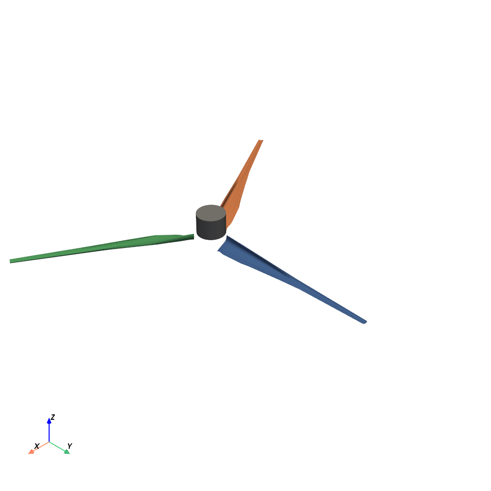
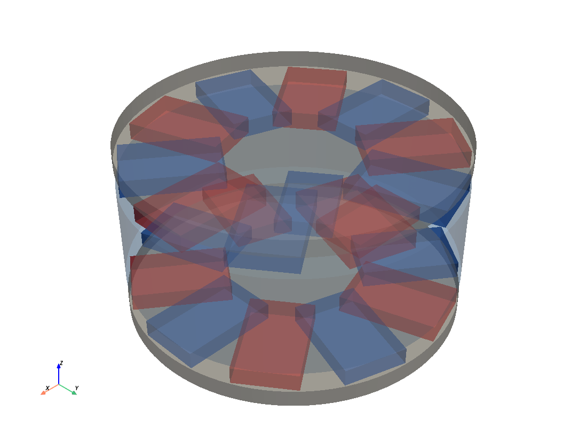
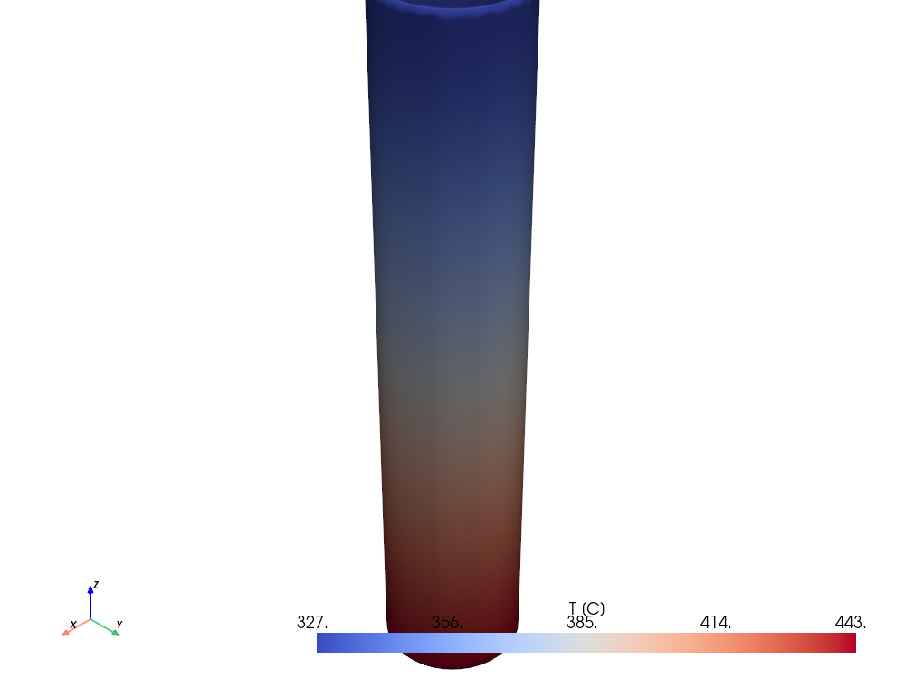
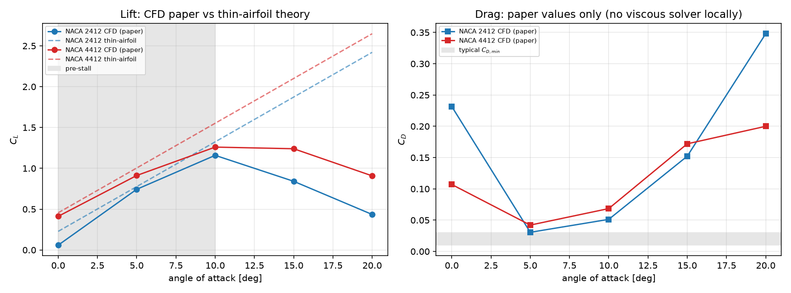

<div align="center">

# 🦖 Paperivore

**An open-source CAD/CAE toolchain that devours papers and grows.**

*Every paper is a meal. Every meal is a test. Every failed test becomes a fix.*

[](LICENSE)


</div>

---

## What this is

Paperivore is a **benchmark-driven build**: instead of writing a CAE toolchain and hoping
it is right, every increment starts by *swallowing a published paper* — an open-access
study with real geometry, real boundary conditions and real numbers — then rebuilding it
from scratch with open-source tools and comparing the answer.

If the numbers match, the toolchain earned a capability. If they don't, one of three
things is true, and finding out which is the actual work:

1. the solver is wrong → fix it and add a regression case;
2. the *reference model* is wrong → fix the reference and write down why;
3. the *paper* is wrong or incomplete → say so, with evidence, and downgrade the claim.

Nothing is tuned to match. A failed case stays failed in the ledger.

**Scope so far:** structural FEA, heat transfer, blade-element aerodynamics, thin-airfoil
theory, and (new) 2D magnetostatics — all on Windows, all open source.

---

## The loop

```
          ┌──────────────────────────────────────────────┐
          │  hunt an open-access paper with hard numbers │
          └───────────────────────┬──────────────────────┘
                                  ▼
                    extract geometry, BCs, ground truth
                                  ▼
                 rebuild with build123d · gmsh · CalculiX
                                  ▼
              compare: solver  vs  analytics  vs  paper
                                  ▼
                 ┌────────────────┴────────────────┐
              agrees                            diverges
                 │                                  │
                 ▼                                  ▼
        record the win                   is it us, the reference,
                 │                        or the paper?
                 │                                  │
                 │                       fix · re-run · document
                 └──────────────► next paper ◄──────┘
```

Each round produces: a runnable script, a report, raw result files, and PNG plots — all
kept in this repository as the receipts.

---

## The ledger

| # | Prey (open-access paper) | What was tested | Verdict | Headline error |
|---|---|---|---|---|
| 1 | Box cantilever (self-check) | STEP → mesh → CalculiX → PyVista pipeline | ✅ pass | 0.0708 mm @ 500 N, 0.1133 mm @ 800 N |
| 2 | NACA 4412 wing (Zenodo) | airfoil geometry + box-spar FEA vs beam theory | ✅ pass | geometry < 0.1 %; tip deflection **+6.7 %** (systematic, mesh-independent) |
| 3 | NACA 2412 / 4412 polars (J. Thermal Eng. 2024) | 10 lift points, lift-curve slope, stall trend | ✅ pass | pre-stall **4.5 – 23 %**; slope error **0.3 %** (2412); stall divergence expected |
| 4 | 25 m HAWT blade (RERA 2026) | Glauert design, BEM `Cp–TSR`, power curve, solid FEA | ✅ pass / ⚠️ | `Cp` **−11 %**, 9 m/s power **−8.9 %**; 14 m/s power **−21.5 %** (polar model) |
| 5 | Exhaust pipe (Thermal Science 2010) | steady conduction + two-sided convection (`*FILM`) | ✅ pass | **0.001 %** vs exact 1D; **0.168 %** vs fin solution |
| 6 | PCB axial-flux motor (arXiv 2509.23561) | magnetic circuit + custom 2D magnetostatics | ❌ fail (honest) | `Kt` **−53 %**, `R` **−40 %** — paper lacks magnet thickness / turn definition |

**Rejected prey** (screened out, kept in `papers/` for transparency): papers whose tables
were internally inconsistent, e.g. an airfoil paper reporting `Cl = 0.0589` at 0° while its
own 5° value implied ≈ 0.23, or force tables that could not be reconciled with their own
coefficients by a consistent reference area.

---

## Gallery

| 25 m wind-turbine blade (BEM + FEA) | PCB axial-flux motor (magnetostatic FEM) |
|---|---|
|  |  |

| Exhaust-pipe temperature field | Airfoil polars: paper vs thin-airfoil theory |
|---|---|
|  |  |

---

## Where the numbers come from

| Capability | Validator | Measured accuracy |
|---|---|---|
| Linear structural FEA | CalculiX `ccx_i8` vs beam theory | tip deflection **+6.7 %** (repeatable, explained by shear lag in a wide thin flange) |
| Heat conduction + convection | CalculiX `*HEAT TRANSFER` vs closed-form | **0.001 %** (uniform), **0.168 %** (axial gradient, fin reference) |
| Lifting-line / thin airfoil | own implementation vs paper polars | slope **0.3 %**, `Cl` pre-stall **4.5 – 23 %** |
| Blade-element momentum | own BEM vs paper `Cp–TSR` | `Cp,max` **−11 %**, power at 9 m/s **−8.9 %** |
| 2D magnetostatics | own scalar-potential FEM vs magnetic circuit | **24 %** disagreement — and the reason is understood (see limits) |

---

## Quick start

```powershell
git clone https://github.com/Tianjian/paperivore.git
cd paperivore

# Python side (numpy / scipy / matplotlib / pyvista / gmsh / build123d)
python -m venv .venv
.venv\Scripts\pip install -r requirements.txt

# Solver side: CalculiX from MSYS2 (no VIP required)
#   pacman -S mingw-w64-ucrt-x86_64-ccx
# then put msys64\ucrt64\bin on PATH

# Run one case end to end
.venv\Scripts\python scripts\model.py  --job results\box-cantilever-500N
.venv\Scripts\python scripts\mesh.py   --job results\box-cantilever-500N
.venv\Scripts\python scripts\deck.py   --job results\box-cantilever-500N
Push-Location results\box-cantilever-500N; ccx_i8.exe -i job; Pop-Location
.venv\Scripts\python scripts\frd_reader.py --job results\box-cantilever-500N
```

Every case in the ledger has its exact command block inside its report in `docs/`.

---

## Repository map

```
docs/        one report per paper — parameters, method, results, verdict, limitations
papers/      the PDFs themselves + licence/provenance table
results/     curated run artefacts per case (json, png, csv, step) — no meshes or solver dumps
scripts/     the toolchain: model → mesh → deck → solve → post → plots
skill/       the agent-facing SOP (how to drive the pipeline, and every pitfall found)
```

| Folder | Start here |
|---|---|
| `docs/` | [toolchain report](docs/CAD-CAE-Windows-Toolchain-Report.md) · [airfoil #1](docs/Airfoil-Validation-Report.md) · [airfoil #2](docs/Airfoil-Validation-2-Report.md) · [wind blade](docs/Wind-Blade-Validation-Report.md) · [thermal](docs/Thermal-Pipe-Validation-Report.md) · [motor](docs/AFPM-EM-Validation-Report.md) |
| `papers/` | [provenance & licences](papers/README.md) |
| `results/` | [result index](results/README.md) |
| `skill/` | [SKILL.md](skill/cad-cae/SKILL.md) — the operational checklist |

---

## House rules

1. **Three verdicts, no fourth.** `pass`, `fail`, `not verifiable`. A number that looks
   plausible but cannot be checked is `not verifiable`, not `pass`.
2. **Never tune to match.** If a coefficient is adjusted until the error closes, the case
   is worthless. Adjustments are allowed only when justified by physics and re-validated.
3. **Audit the paper too.** Reference models and published tables get the same scrutiny as
   the solver. Three of the six rounds ended with a finding about the paper.
4. **Keep the failure.** Failed cases stay in the ledger with their error bars.
5. **Every fix gets a regression.** A bug found by one paper becomes a guard rail for the
   next one — the pitfalls list in `skill/` is the accumulated memory.

---

## The stack (all open source)

| Layer | Tool | Notes |
|---|---|---|
| CAD | **build123d** 0.13 (OCCT 8.0) | parametric solids, STEP/STL export |
| Meshing | **gmsh** 4.15 (Python API) | never the `.geo` text dialect — use the API |
| Structural / thermal FEA | **CalculiX** 2.23 `ccx_i8` | PaStiX build crashes (0xC0000005) on this box; the i8 build works |
| Post | **PyVista** 0.49 + own FRD reader | `ccx2paraview` breaks on numpy ≥ 2 |
| 2D plots | **matplotlib** | |
| Projection / human review | **FreeCAD** 1.1.4 | no headless PDF/SVG; DXF is geometry-only |
| Runtime | Python 3.13, numpy, scipy | |

---

## Known limits (stated up front)

- **No viscous CFD.** Aerodynamics is BEM + thin-airfoil + panel-level methods. No drag
  prediction, no separation, no stall onset.
- **No 3D electromagnetics.** The 2D magnetostatic solver cannot close the flux path of a
  single-stator axial-flux machine (the return path is radial); that case is deliberately
  reported as a known-inadequate model rather than a passing one.
- **2D heat transfer ignores what 2D ignores.** Solved by adding an axial-conduction fin
  reference — the residual 0.17 % is the 3D effect.
- **No radiation, no conjugate heat transfer, no contact, no composites layup.**
- **Windows-first.** Scripts use PowerShell; the Python side is portable.

---

## Contributing: bring prey

A good paper for the bench has: complete geometry, explicit boundary conditions, at least
one tabulated or plotted number that can be digitised, and an open licence.

Add a case by opening a PR with:

```
docs/<case>-report.md      parameters · method · result · verdict · limits
scripts/<case>_*.py        the runnable pipeline
results/<case>/            result.json + the key PNGs/CSVs
papers/README.md           one new row: source · licence · what was extracted
```

Cases that *fail honestly* are as welcome as cases that pass — arguably more.

---

## Licence

- **Code** (`scripts/`, `skill/`): MIT — see [LICENSE](LICENSE).
- **Reports** (`docs/`): CC BY 4.0.
- **Papers** (`papers/`): remain under their own licences; they are redistributed here only
  for reproducibility, with source and licence recorded in [papers/README.md](papers/README.md).
  Rights holders can request removal via an issue and the file will be deleted.

---

<div align="center">
<sub>Built on Windows with an agent in the loop — every number in this repo was produced by
running the code, not by copying a table.</sub>
</div>
