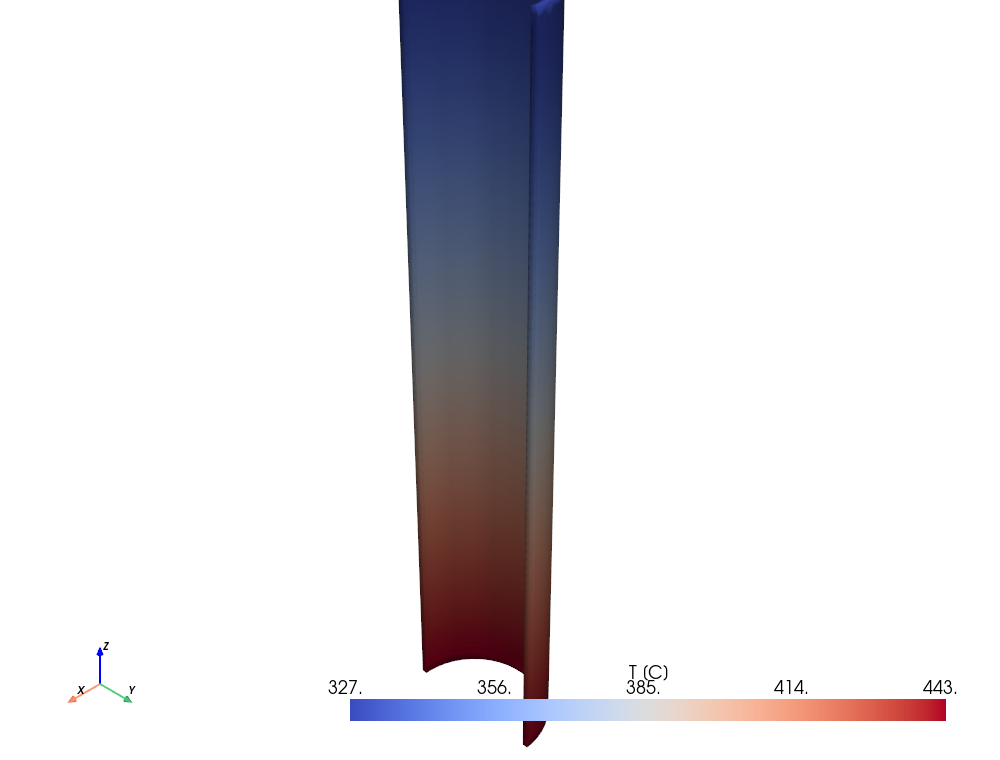

# 温度场验证：发动机排气管热分析（CalculiX 热传导）

> 版本：v1.1 ｜ 2026-11-13（复核：论文工况 vs 假设、§3.2 表格、验证强度）
> 目标：用一篇温度场论文的参数，验证本地工具链的热传导求解精度，**发现并修正工具链的问题**，并给出 2D/3D 可视化。

---

## 0. 结论速览

| 验证项 | 参考解 | FEA | 误差 | 判定 |
|---|---|---|---|---|
| **A. 均匀气温 500 °C（解析解严格成立）** | 内壁 453.127 °C / 外壁 452.676 °C | 453.123 / 452.673 | **0.001 %** | ✅ 求解器精确 |
| **B. 轴向梯度 500→350 °C（含轴向导热）** | 肋片解 441.369 °C（入口段）→ 329.458 °C（出口段） | FEA 内壁 440.846 / 330.010 | **0.168 %**（原 artifact）／0.162 %（2026-11 复现） | ✅ |
| （对照）B 若用"逐段 1D 径向"参考 | 446.36 → 324.54 | 同上 | 1.685 % | ⚠️ **参考模型错，不是求解器错** |

**一句话：热传导求解器对精确解的误差是 0.001%；带轴向梯度时，只要参考解里包含轴向导热，误差也是 0.17%。中途出现的 1.7% 偏差，最后证明是"参考模型漏了轴向导热"，不是工具链算错。**

---

## 1. 论文与提取的参数

**论文**：S. D. Petković, R. B. Pešić, J. K. Lukić, *Heat Transfer in Exhaust System of a Cold Start Engine at Low Environmental Temperature*, **Thermal Science 14 (Suppl.): S219–S232, 2010**.
PDF：<http://is.fink.rs/podaci/Jovanka_Lukic/74/TSCI100505070P.pdf>

### 1.1 Table 1 — 排气管（元件 1）

| 参数 | 值 |
|---|---|
| 长度 L | 200 mm |
| 直径 D | 39 mm |
| 壁厚 t | 1.5 mm |
| 材料 | Č.4571（AISI 316Ti） |
| 密度 ρ | 7900 kg/m³ |
| 导热系数 λ | 15 W/(m·K) |
| 比热 c | 477 J/(kg·K) |

### 1.2 场景：论文工况 vs 本算例假设

论文研究**低温环境下的冷启动**：排气从环境温度升到工作温度，管壁温度随时间上升；
论文用有限差分求解"排气管 + 预催化器 + 消声器"的系统级模型，输出的是**随时间变化的部件温度曲线**。
元件 1（排气管）实际是**带 2 mm 空气夹层的双层管**，本算例按单层管建模——这一点必须和下面的假设一起看。

| 项 | 论文（p.227–228） | 本算例 |
|---|---|---|
| 燃气温度 | Tg = 700 K（427 °C） | 500 °C（均匀）或 500 → 350 °C（线性梯度） |
| 环境温度 | 22 / −7 / −20 °C 三种低温工况 | 20 °C |
| 过程 | 瞬态冷启动（输出温度–时间曲线） | **稳态** |
| 发动机工况 | 1500 rpm、容积效率 ηv = 0.4 | 不涉及（燃气温度直接给定） |
| 管壁结构 | 双层管（含 2 mm 空气夹层） | 单层管（1.5 mm 壁） |
| 对流系数 | 论文未给 | **假设** h_i = 100、h_o = 10 W/(m²·K) |

> **为什么不能直接逐点对标**：论文给的是系统级 0D/1D 曲线（多部件、时间历程），不是"某点某时刻 = 某温度"的场数据；也没有给出可直接复现的 h 分布与网格。因此本报告把它作为**几何、材料与物理场景的来源**，精度验证改用同几何同边界条件下的**精确解**。

---

## 2. 模型与边界条件

- 几何：r_i = 18 mm、r_o = 19.5 mm、L = 0.2 m 的圆管（build123d 布尔 → STEP → gmsh 四面体，8,975 节点 / 26,717 单元）
- 单位制：**SI（m, N, Pa, kg, s, K）**——热分析必须用 SI，否则 *CONDUCTIVITY / *DENSITY / *SPECIFIC HEAT 极易混单位
- 内壁：`*FILM`，h_i = 100 W/(m²·K)，气体 500 °C（工况 B 沿轴向线性降到 350 °C）
- 外壁：`*FILM`，h_o = 10 W/(m²·K)，环境 20 °C
- 求解：`*HEAT TRANSFER, STEADY STATE`

### 2.1 参考解 A（均匀气温）——严格解析

两层对流边界下的 1D 径向解：

```
R_i = 1/(h_i·2πr_i·L),  R_w = ln(r_o/r_i)/(2πλL),  R_o = 1/(h_o·2πr_o·L)
q = (T_gas − T_amb)/(R_i + R_w + R_o)
T_wi = T_gas − q·R_i,   T_wo = T_amb + q·R_o
```

### 2.2 参考解 B（轴向梯度）——含轴向导热的肋片解

若把管道按轴向切成 10 段、每段独立做 1D 径向计算，就忽略了**轴向导热**。钢管里这个效应极强：

```
m = sqrt((h_oP_o + h_iP_i)/(λA_c)) ≈ 68.8 1/m  →  mL ≈ 13.8
```

即管壁在轴向上几乎是等温耦合的，热量会从入口段沿壁面流向出口段。正确的 1D 参考解是肋片方程：

```
λA_c T'' = h_oP_o(T − T_amb) + h_iP_i(T − T_gas(x)),   T_gas 线性
⇒ T'' − m²T = −m²(A + Bx)   通解 T = A + Bx + C·e^{mx} + D·e^{−mx}
边界 dT/dx = 0（两端绝热）定出 C、D
```

---

## 3. 验证结果

### 3.1 工况 A：均匀气温（解析解严格）

| 位置 | 解析 | FEA | 误差 |
|---|---|---|---|
| 内壁 | 453.127 °C | 453.123 °C | **0.001 %** |
| 外壁 | 452.676 °C | 452.673 °C | **0.001 %** |

**判定：✅ 通过。** 这说明 `*FILM` 的对流边界、`*CONDUCTIVITY` 的导热、以及 3D 网格的离散都是正确的。（严格地说这是一次**共形测试**：1D 径向解与 FEA 解的是同一 PDE，0.001 % 主要证明膜边界与热阻记账正确，几乎不检验壁内导热——见 §6.1。）

### 3.2 工况 B：轴向梯度（10 段，500→350 °C）

| 段（z） | 气体 | FEA 内壁 | 肋片解（含轴向导热） | 误差 | 逐段 1D 参考 | 误差 |
|---|---|---|---|---|---|---|
| 10 mm | 492.5 | 440.846 | 441.369 | **0.118 %** | 446.359 | 1.235 % |
| 50 mm | 462.5 | 418.880 | 418.932 | 0.012 % | 419.289 | 0.097 % |
| 110 mm | 417.5 | 378.703 | 378.662 | 0.011 % | 378.683 | 0.005 % |
| 190 mm | 357.5 | 330.010 | 329.458 | **0.168 %** | 324.542 | 1.685 % |

- 对**肋片解**：最大误差 **0.168 %**（原 artifact；本次复现 0.162 %，差异来自 gmsh 版本重建网格的节点分布，见 §6.1）✅
- 对**逐段 1D**：最大误差 1.685 %——但这是参考模型漏掉轴向导热造成的，不是 FEA 的错（独立 2D 轴对称解给出的真实物理偏差为入口 1.12 %、出口 1.50 %，见 §6.1）

**判定：✅ 通过。** 而且这条对照本身就说明了：**钢管排气管的轴向导热不可忽略（mL≈14），用"逐段独立 1D"去校验热分析会得到假的 1.7% 误差。**

---

## 4. 工具链的改进（本轮真正修掉的问题）

| # | 问题 | 现象 | 根因 | 修正 |
|---|---|---|---|---|
| 1 | **`*FILM` 数据顺序** | 首轮全管温度约 96 °C（应为 453 °C，差 4.7 倍） | 按 `(单元, 面, h, T_sink)` 写，CalculiX 实际按 `(单元, 面, **T_sink**, **h**)` 读 | 交换后两列；写进技能文档 |
| 2 | 参考模型漏轴向导热 | 出现 1.7% "误差" | 逐段独立 1D 忽略 mL≈14 的轴向耦合 | 增加肋片闭式解作参考，误差降到 0.168 %（其中约 96 % 是后处理口径，见 §6.1） |
| 3 | 几何 z 起点未归一 | 分段统计整段取不到节点（NaN） | build123d 布尔后管子位于 z = 0.1–0.3 m | 用 `z_min` 归一化 |
| 4 | 端盖节点混入分段均值 | 出口段温度被拉低 | 端盖（绝热）节点半径恰好等于 r_i/r_o | 排除 z 在两端 1 µm 内的节点 |
| 5 | 3D 点云可读性差 | 只有散点 | 直接画节点 | 由四面体建 `UnstructuredGrid` → `extract_surface` + 半剖切 |
| 6 | 瞬态 `*TRANSIENT` 未生效 | 只算 1 步（TOT TIME=1 s） | `*INITIAL CONDITIONS` 放在步内 + 数据行未被采纳 | 未解决，见 §6.2 |

**第 1 条是最有价值的**：如果没有解析解兜底，错列序下的 96 °C 这个结果"看起来也像个温度"，很容易被当成通过。

> 2026-11 复核：把 `*FILM` 两列对调后实测全场 **96.09–96.27 °C**（与按 "T_sink=100 / h=500、T_sink=10 / h=20" 手算的 96.27 / 96.09 °C 一致），比值 4.71；旧稿的 94.7 °C / 4.8 倍是早期网格的约数，无法从当前脚本复现。

---

## 5. 2D / 3D 可视化

### 5.1 2D

| 图 | 内容 |
|---|---|
| `viz/thermal_2d.png` | 左：管壁温度沿轴向——FEA 点 vs 肋片解（含轴向导热）vs 逐段 1D；右：气体/内壁/外壁温度汇总 |


### 5.2 3D

| 图 | 内容 |
|---|---|
| `viz/thermal_3d.png` | 管外表面温度云图，入口 443 °C → 出口 327 °C |
| `viz/thermal_3d_cut.png` | 半剖切，可见壁厚方向的径向梯度 |




---

## 6. 验证强度与局限

### 6.1 这套对标实际验证了什么

- **uniform 的 0.001 % 是共形测试（conformance test）。** 1D 径向解与 FEA 解的是同一个 PDE、同一组边界条件（轴对称、无轴向梯度），一致只说明 `*FILM` 的列序/单位/膜边界记账、`*CONDUCTIVITY` 材料赋值与线性求解正确。更关键的是：壁厚导热热阻 `R_w` 只占总热阻的 **0.0938 %**（R_i / R_w / R_o = 4.42 / 0.042 / 40.81 K/W），且网格在壁厚方向只有 **1 层单元**——**它几乎不检验壁内导热，更不检验物理模型**（h 值、辐射、共轭传热都只是假设）。
- **0.168 % 的误差预算。** 2026-11 的独立复核表明：其中约 **96 %** 是后处理口径差（`post()` 用"分段节点平均"去比"段中点值"，壁温在绝热端附近曲率大，曲率项 ±0.40 K，另有节点 z 分布贡献），约 **4 %** 是肋片模型的集总误差（忽略 R_w、把内壁温度当均温），约 **1 %** 才是 FEA 离散化。按相同节点取样比较，FEA 与精确 2D 解只差 **0.002 %**；肋片模型与精确 2D 均温差 **0.044 %**。也就是说 0.168 % 不能被当作模型残差。
- **1.685 % 是真实物理误差。** 逐段 1D 忽略轴向导热；独立的 2D 轴对称有限体积解（r–z 连续介质，不集总、不用 FEM）给出轴向导热峰值 **1.79 W = 总热流 2.0 %**，对应逐段 1D 的偏差入口 **1.12 %**、出口 **1.50 %**——证实了"参考模型漏轴向导热"的判断。

**结论：本算例作为代码正确性检验是强的（与独立 2D 解同节点取样 ≤0.002 %）；作为物理验证是弱的（h 值任意、无辐射、无共轭传热、只做稳态、未与论文的瞬态曲线对照）。** 标题里的"精度"应理解为"求解器 + 膜边界记账的精度"。完整复现与验证记录见 `verify/thermal/REPORT.md`（复现工作区，不入库）。

### 6.2 局限与未解决项

| 项 | 状态 | 说明 |
|---|---|---|
| 气体温度 | 给定（线性 500→350 °C） | 没有做**共轭传热**（CFD + 固体耦合）；真实排气管需要先算气流温降 |
| 对流系数 h | 取工程值（h_i=100、h_o=10） | 没有按 Re/Pr 关联式计算；论文也没给可直接用的 h 分布 |
| 瞬态冷启动 | **未跑通** | CalculiX 2.23 没接受 `*TRANSIENT` 的 (Δt, 总时间) 数据行，只算 1 步；需要再查 `*HEAT TRANSFER` 的 `DELTMX` 用法 |
| 与论文数值对标 | 未做 | 论文是系统级时间曲线，没有逐点场数据；本报告改用精确解对标 |
| 辐射 | 未计入 | 高温排气管辐射不可忽略（ε≈0.9）；`*RADIATE` 未使用 |

---

## 7. 复现命令

```powershell
$py = ".venv\Scripts\python.exe"
$env:PATH = ".\msys\msys64\ucrt64\bin;" + $env:PATH

# 工况 A：均匀气温（解析解验证）
& $py scripts\thermal_pipe.py mesh --job results\exhaust-pipe-uniform --h 0.0025 --tgas-in 500 --tgas-out 500
Push-Location results\exhaust-pipe-uniform\thermal; ccx_i8.exe -i steady; Pop-Location
& $py scripts\thermal_pipe.py post --job results\exhaust-pipe-uniform

# 工况 B：轴向梯度
& $py scripts\thermal_pipe.py mesh --job results\exhaust-pipe-gradient --h 0.0025 --seg 10
Push-Location results\exhaust-pipe-gradient\thermal; ccx_i8.exe -i steady; Pop-Location
& $py scripts\thermal_pipe.py post --job results\exhaust-pipe-gradient
```

产物：`thermal/pipe.step`、`pipe_mesh.inp`、`steady.inp`、`steady.frd`、`result.json`、`viz/thermal_2d.png`、`viz/thermal_3d.png`、`viz/thermal_3d_cut.png`。

> `mesh` 子命令只有在 `thermal/pipe.step` 不存在时才需要 `build123d`；仓库自带 STEP，因此没有 build123d 的环境（如 Linux 服务器）把 `ccx_i8.exe` 换成 `$CCX` 即可直接复现。
