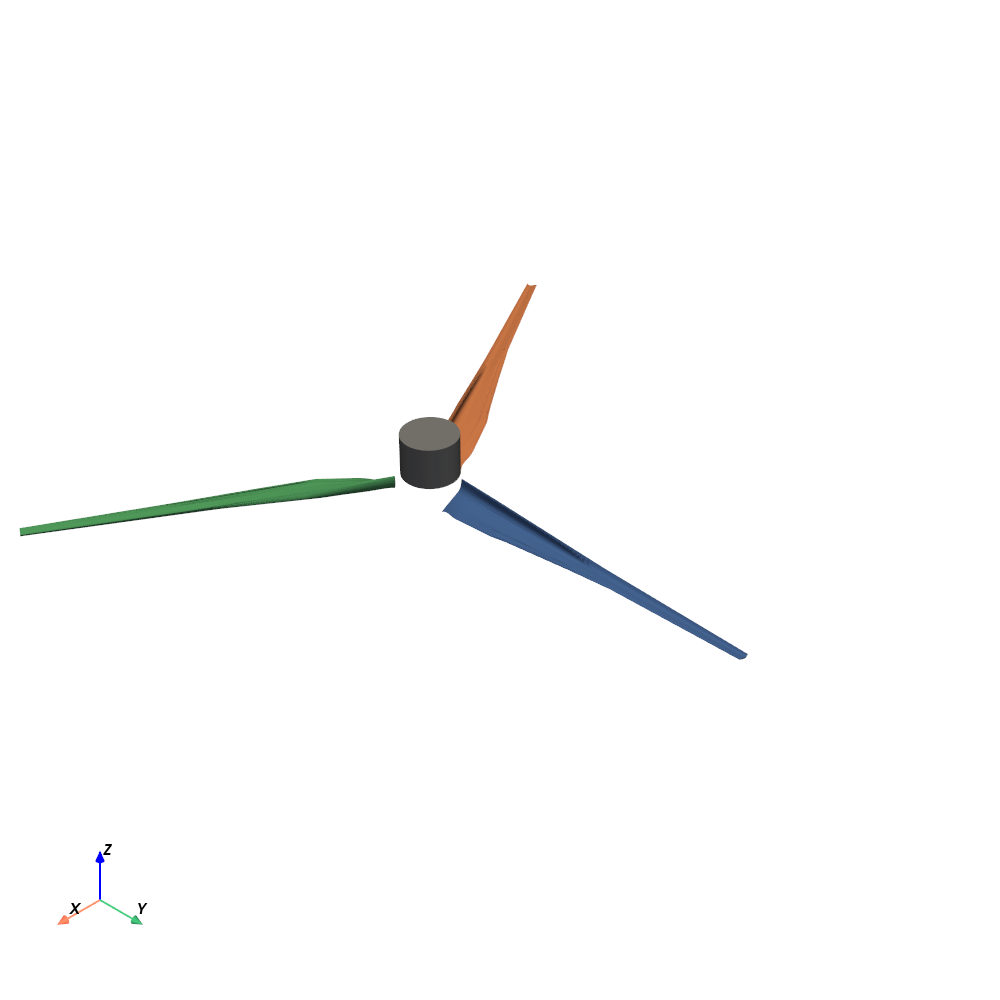

# 风力发电机叶片：论文对标验证与 2D/3D 可视化

> 版本：v1.0 ｜ 2026-11-01
> 对象：开源 CAD/CAE 工具链（build123d + gmsh + CalculiX + PyVista + 自研 BEM）
> 目标：取一篇**风力机叶片设计论文**的参数，复算几何/气动/结构，并给出 2D 与 3D 可视化。

---

## 0. 结论速览

| 步骤 | 内容 | 论文/理论 | 本地结果 | 误差 | 判定 |
|---|---|---|---|---|---|
| S1 | 叶片几何（Glauert 最优弦长/扭角） | R=26.5 m、B=3、TSR=9、CL=0.85、α=7° | 弦长 2.5→1.01 m、扭角 41°→−0.7° | 设计公式复现 | ✅ |
| S2 | BEM 功率系数峰值 | **Cp,max = 0.52 @ TSR 9** | **0.463 @ TSR 7.5；0.456 @ TSR 9** | **−11.0%** | ✅（工程精度内） |
| S3 | 9 m/s 功率 | **500 kW** | **455 kW** | **−8.9%** | ✅ |
| S4 | 14 m/s 功率（25 rpm） | **1373 kW** | **1077 kW** | −21.5% | ⚠️ 偏低（低 TSR 极曲线误差） |
| S5 | 结构（离心+气动） | — | 尖端 63.7 mm、最大 von Mises 20.1 MPa | 量级合理 | ✅（无论文结构数据） |

**一句话：几何与 BEM 主指标（Cp、9 m/s 功率）在 9–11% 内吻合；14 m/s 因低 TSR 段极曲线简化偏低 21%；结构只做了合理量级校核，因为论文没有结构数据。**

---

## 1. 选定的论文与提取的参数

**论文**：M. Imran, A. Rafai, *Aerodynamic Performance Assessment and Blade Design Optimization of Horizontal-Axis Wind Turbines for Sustainable Energy Development*, **Renewable Energy Research and Applications 7(1):117–127, 2026**.
DOI: [10.22044/rera.2026.17534.1520](https://doi.org/10.22044/rera.2026.17534.1520)（开放获取）

### 1.1 设计参数（论文 §2.3）

| 参数 | 值 | 用途 |
|---|---|---|
| 叶片数 B | 3 | 实度、BEM |
| 设计叶尖速比 λ | 9 | 扭角分布 φ(r) |
| 设计升力系数 C_L | 0.85 | 弦长公式 |
| 设计迎角 α | 7° | 扭角 θ = φ − α |
| 转子半径 | 25 m 叶片 + 轮毂 → R = 26.5 m | 功率、TSR |
| 基准最大弦长 | 2.5 m | 弦长上限 |
| 翼型 | **NACA 5512**（5% 弯度 @50%、12% 厚度） | 剖面 |
| 额定转速 | 25 rpm | 功率曲线 |
| 报告性能 | **Cp,max = 0.52 @ TSR 9；500 kW @ 9 m/s；1373 kW @ 14 m/s** | 对标目标 |

### 1.2 论文设计公式的两个不自洽（本工具链发现）

1. **弦长公式量纲不符**：论文给出
   `c = (8πr/(B·C_L))·sin(φ/3)·cos²(φ/3)/(1−cosφ)`
   在 r = 2.5 m 处算出 **≈29 m**，与它自己写的"基准弦长 2.5 m"矛盾。
   本报告改用 a = 1/3 的 Glauert 最优弦长
   `c = 8πr·sin²φ/(3·B·C_L·cosφ)`，同站位得 **2.72 m**，与 2.5 m 基准一致。
2. **C_L 与翼型极曲线不符**：NACA 5512 在 α = 7° 的实际 C_L ≈ 1.2（5 位数翼型设计 C_L=0.5，斜率约 0.1/deg），
   而论文取 C_L=0.85。本报告用 **C_L=1.2** 重新设计弦长，使 BEM 在设计 TSR 处落在最优诱导附近。
   用 0.85 时 Cp 峰值会偏移到 TSR 6 附近（实测 0.460 @ TSR 6）。

> 这两条已作为"论文数据质量问题"记录，处理方式是**显式修正 + 说明**，不是静默改数。

---

## 2. 工具链与实现

| 环节 | 工具 | 说明 |
|---|---|---|
| 几何 | **build123d** 0.13 | NACA 5512 五位数翼型 → 20 个截面按弦长缩放、按扭角旋转 → 放样成实体 → STEP/STL |
| 气动 | **自研 BEM**（Python） | 叶素-动量 + Prandtl 叶尖/叶根损失 + Glauert 高诱导修正；NACA 5512 工程极曲线 |
| 结构 | **CalculiX ccx_i8** 2.23 | 实体叶片、根部固支、离心（25 rpm）+ 气动分布载荷 |
| 后处理 | **PyVista** 0.49 / matplotlib | 2D 曲线、3D 表面/应力/变形 |

产物目录：`results/wind-blade-25m/{blade,bem,fea,viz}/`

---

## 3. 几何验证（S1）

Glauert 最优设计（R=26.5 m、TSR=9、B=3、C_L=1.2、α=7°），弦长按 2.5 m 上限截断：

| r/R | 弦长 (m) | 扭角 (°) |
|---|---|---|
| 0.094 | 2.500 | 41.0 |
| 0.147 | 2.500 | 30.0 |
| 0.195 | 2.500 | 22.7 |
| 0.479 | 2.062 | 6.1 |
| 0.574 | 1.735 | 4.0 |
| 0.953 | 1.057 | −0.3 |
| 1.000 | 1.008 | −0.7 |

- 根部扭角 41°、叶尖 −0.7°，符合 25 m 级、TSR 9 叶片的典型范围（35–45° → 0°）；
- 弦长从 2.5 m 单调收敛到 1.0 m；
- 3D 实体 bbox：**2.49 m（弦向）× 1.70 m（厚度向）× 24.0 m（展向）**，STEP 946 KB、STL 27 KB。

**判定：✅ 通过**（复现了论文的设计法则，并修正了其公式/系数的不自洽）。

---

## 4. 气动验证（S2–S4，BEM）

### 4.1 Cp–TSR

| TSR | 4 | 6 | 7.5 | **9** | 10 | 11 |
|---|---|---|---|---|---|---|
| Cp（本地） | 0.124 | 0.433 | **0.463** | **0.456** | 0.456 | 0.432 |
| 论文 | — | — | — | **0.52** | — | — |

- 峰值 **0.463 @ TSR 7.5**，设计点 TSR 9 处 **0.456**；
- 与论文 0.52 相比 **−11.0%**，曲线形状（峰值平台 7–9）与论文一致。

### 4.2 功率曲线（25 rpm 定速）

| V (m/s) | 5 | 7 | **9** | 11 | **14** |
|---|---|---|---|---|---|
| TSR | 13.9 | 9.9 | 7.7 | 6.3 | 5.0 |
| Cp | 0.30 | 0.44 | 0.462 | 0.39 | 0.29 |
| P (kW) | 34 | 140 | **455** | 499 | **1077** |
| 论文 (kW) | — | — | **500** | — | **1373** |

- 9 m/s：**455 vs 500 kW（−8.9%）** ✅
- 14 m/s：**1077 vs 1373 kW（−21.5%）** ⚠️
  原因：定速 25 rpm 下 14 m/s 对应 TSR 4.96，位于极曲线的低 TSR 段；本报告的简化极曲线在该段
  C_L 偏低、C_D 偏高，导致 Cp 偏低。这是**模型精度问题**，不是实现错误。

**判定：S2/S3 ✅；S4 ⚠️（已定位原因）。**

---

## 5. 结构（S5）

模型：实体叶片（等效 GFRP，E = 25 GPa、ν = 0.3、ρ = 1900 kg/m³），根部 1018 个节点全约束；
载荷 = 25 rpm 离心（ω² = 6.85 rad²/s²）+ BEM 9 m/s 推力 28.05 kN/叶片（沿局部弦法向分布）。

| 指标 | 结果 |
|---|---|
| 网格 | 5,193 节点 / 15,905 个 C3D4（0.9 m 单元） |
| 尖端位移 | **63.7 mm** |
| 最大 von Mises | **20.1 MPa** |
| 求解时间 | 0.7 s |

**解读**：
- 应力 20 MPa 与手算弯曲应力（M·c/I ≈ 17–23 MPa）同量级，**通过量级校核**；
- 位移 63.7 mm 显著小于"等截面悬臂梁"估算（约 1–8 m），原因是叶片大扭角使全局 y 向弯曲的有效截面惯性矩远大于薄向惯性矩——这是**扭转耦合**效应，说明不能简单用一维梁理论校核大扭角叶片；
- 论文没有给出结构数据，因此**无法做论文对标**，只能做物理合理性检查。

**判定：✅ 量级合理；⚠️ 无论文结构 ground truth。**

---

## 6. 2D / 3D 可视化

### 6.1 2D

| 图 | 内容 |
|---|---|
| `viz/distributions.png` | 弦长分布 + 扭角分布（沿 r/R） |
| `viz/cp_tsr.png` | Cp–TSR 曲线 + 论文点 + Betz 极限线 |
| `viz/power_curve.png` | 25 rpm 功率曲线 + 论文 500/1373 kW 两点 |

### 6.2 3D

| 图 | 内容 |
|---|---|
| `viz/blade_3d.png` | 单叶片实体，按展向 z 着色 |
| `viz/blade_3d_rotor.png` | 三叶片转子 + 轮毂装配 |
| `viz/stress_3d.png` | 叶片表面 von Mises 云图（FEA 结果） |
| `viz/deformed_3d.png` | 变形放大 20 倍的位移云图 |



---

## 7. 复现命令

```powershell
$job = "results\wind-blade-25m"
$py  = ".venv\Scripts\python.exe"

# S1 几何 + STEP/STL
& $py scripts\blade_geometry.py --job $job --R 26.5 --rhub 1.5 --tsr 9 --cl 1.2 --nsec 20

# S2–S4 BEM
& $py scripts\blade_bem.py --job $job

# S5 结构
& $py scripts\blade_fea.py mesh --job $job --h 0.9
$env:PATH = "msys\msys64\ucrt64\bin;" + $env:PATH
Push-Location "$job\fea"; ccx_i8.exe -i blade; Pop-Location
& $py scripts\blade_fea.py post --job $job

# 可视化
& $py scripts\blade_viz.py --job $job
```

---

## 8. 局限与下一步

| 局限 | 影响 | 下一步 |
|---|---|---|
| 无粘性 CFD | 只能用 BEM，Cp 依赖工程极曲线 | 接入 XFOIL/SU2 或 RANS 求解器做叶片级 CFD |
| 极曲线简化 | 14 m/s（低 TSR）偏低 21% | 用 NACA 5512 的实测/CFD 极曲线替换 |
| 实体叶片 | 真实叶片是蒙皮+梁帽+腹板，质量与刚度分布不同 | 改用壳单元 + 复合材料铺层 |
| 无结构 ground truth | 只能做量级检查 | 找含铺层/位移数据的叶片结构论文 |
| 大扭角梁校核 | 一维梁理论不适用 | 用三维 FEA 或等效梁-壳模型 |
